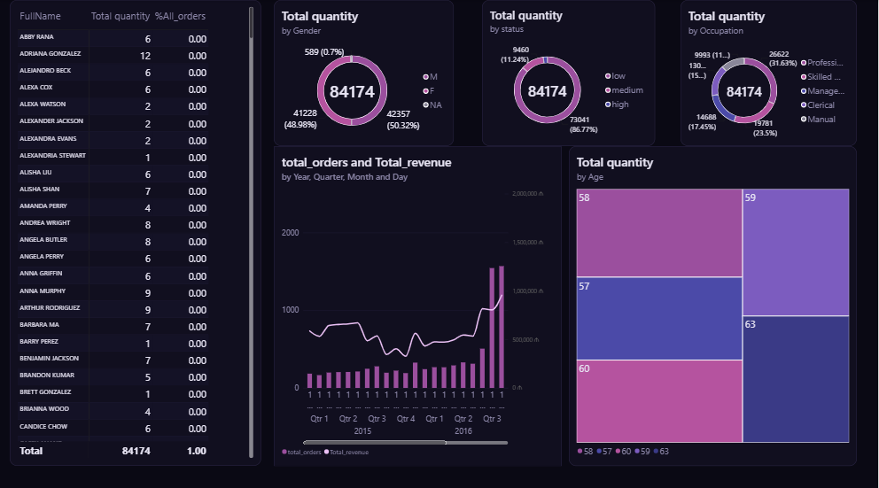

# Sales Analysis Dashboard (Power BI)

An interactive 3-page Power BI dashboard built on the Adventure Works sales dataset. The goal was not just to display numbers, but to uncover insights that create real business value.

## Dashboard pages
- **Overview:** revenue, orders and returns KPIs vs. target, category and subcategory performance, continent slicer
- **Products:** drillthrough to product level, gauges, revenue and returns trends
- **Customers:** customer profile by gender, occupation and age, monthly dynamics

## Key insights
- Total revenue ~$24.9M, profit ~$10.5M (margin ~42%)
- Bikes generate ~95% of revenue; Accessories make up ~69% of units sold but only ~5% of profit
- The US and Australia together drive ~62% of revenue
- Return rate stays stable at ~2.2%

## Tools
Power BI Desktop, DAX, Data Modeling (star schema), Drillthrough, Slicers

## Files
- `ismat.ahmadli.pbix` - Power BI report (open with Power BI Desktop)
- `image.png` - dashboard preview

## Author
Ismat Ahmadli - junior data analyst
